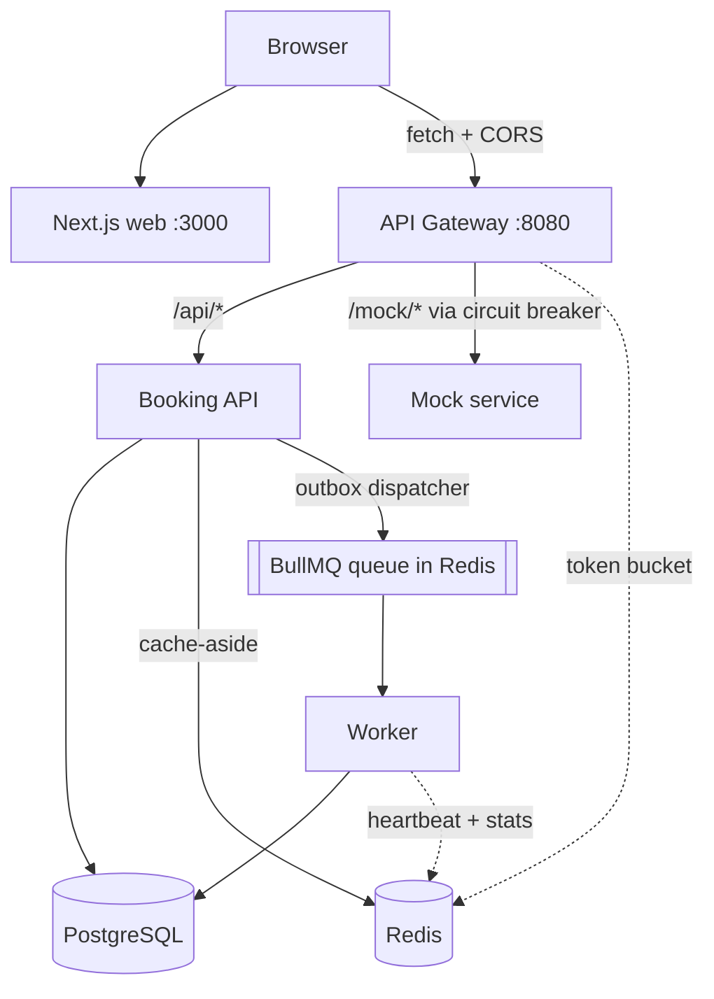

# FlashSale: Distributed Event Booking & Ticketing

FlashSale is an event ticket platform built to show, with working code, how a distributed system survives **flash-sale traffic**: many users hitting the same scarce inventory at once, with dependencies that sometimes fail.

> Every claim below is backed by a test or a measured run. See [docs/testing-report.md](docs/testing-report.md), [docs/load-test-report.md](docs/load-test-report.md) and [docs/implementation-audit.md](docs/implementation-audit.md) for what was run and what was not.

## 1. Problem statement

A ticket seller announces a popular event. Within seconds thousands of people try to buy the last few hundred tickets. A naive system oversells, double-charges retried requests, melts down under the spike, or hangs forever when a dependency is slow.

## 2. Objectives

| Goal | How FlashSale meets it |
|---|---|
| Never oversell | Atomic conditional `UPDATE` inside a PostgreSQL transaction + `CHECK` constraint |
| Safe retries | `Idempotency-Key` header, unique constraint, request fingerprint |
| Survive spikes | Redis Token Bucket at the gateway, cache-aside reads, async confirmation |
| Do not lose work | Transactional outbox → BullMQ → worker, at-least-once with idempotent processing |
| Contain failures | Circuit breaker, timeouts, bounded retries, graceful degradation |
| See what is happening | Request IDs end to end, JSON logs, Prometheus metrics, live dashboard |

## 3. Features

- Event discovery: search, categories, city/date/price filters, sorting, featured + trending rails, saved events.
- Event details, quantity selector capped by availability, booking flow with confirm dialog and live async status tracker.
- My bookings with auto-refresh while processing.
- **System monitor** dashboard (real metrics, charts, service health, circuit breaker, "n/a" when a number cannot be measured).
- **Playground**: rate limiter burst, cache hit/miss, async worker lifecycle with injected failures, circuit breaker scenarios, load-test results.
- **Live flash-sale simulator** (`/simulator`): N virtual users (default 10 users x 10 tickets, 8 impatient clicks each) hit Book at once against a hidden 50-ticket demo event; live charts of accepted / duplicate-click / sold-out / rate-limited / error counts, the booking pipeline (processing, confirmed, failed), remaining stock, a per-user table, an invariant check ("no overselling, DB consistent, no duplicate bookings, worker drained"), and a live panel showing every service (gateway, booking-api, PostgreSQL, Redis, worker, mock) plus queue / outbox / cache / DB-pool numbers.
- **Accounts**: sign up / log in / log out (`/signup`, `/login`). Passwords are hashed with scrypt, sessions are opaque revocable tokens, login and sign-up have their own stricter rate limit. Logged-in users book as themselves and see "My bookings" without typing an email. Guest booking still works.
- Docker Compose stack of 7 services; only the web UI and the gateway are published.

## 4. Technology stack

Next.js 16 · React 19 · TypeScript · Tailwind CSS 4 · Recharts · Node.js 22 · Express 5 · PostgreSQL 16 · Redis 7 · BullMQ · Docker Compose · k6 · Vitest · Playwright · pino (JSON logs) · prom-client (Prometheus format).

## 5. Architecture



Details: [docs/architecture.md](docs/architecture.md). Only `web` and `gateway` publish host ports; PostgreSQL, Redis, the Booking API, the worker and the mock service live on an `internal` Docker network.

## 6. Data flow (booking)

1. Browser `POST /api/bookings` with an `Idempotency-Key` → gateway (request ID, rate limit) → Booking API.
2. One PostgreSQL transaction: upsert user → `UPDATE events … WHERE available_capacity >= qty` → insert booking → insert outbox row → `COMMIT`.
3. API answers **202 Accepted** (`status: PROCESSING`).
4. The outbox dispatcher claims the row (`FOR UPDATE SKIP LOCKED`) and enqueues a BullMQ job with a deterministic job id.
5. The worker confirms the booking (`UPDATE … WHERE status='PROCESSING'`). The UI polls `GET /api/bookings/:id` and shows `CONFIRMED`.

Sequence diagrams: [docs/data-flow.md](docs/data-flow.md).

## 7. Folder structure

```
apps/
  gateway/        Express gateway: proxy, token bucket, circuit breaker, retry, health, metrics
  booking-api/    Events + bookings API, cache, outbox dispatcher, migrations runner, seed
  worker/         BullMQ consumer, heartbeat, compensation on permanent failure
  mock-service/   Fault-injectable downstream
  web/            Next.js UI (discover, event, booking, my bookings, monitor, playground)
packages/common/  Shared logger, env helpers, request-id, Redis factory, error shape
database/migrations/  Versioned SQL migrations
load-tests/       k6 scripts + results/ (JSON reports)
tests/            unit/ integration/ fault/ e2e/ helpers/
docs/             Architecture, API, design and test documentation
scripts/run-k6.mjs  Runs k6 locally or via the official Docker image
```

## 8. Prerequisites

Docker Desktop (Compose v2) · Node.js 22+ and npm (only for running tests from the host) · k6 *optional* (the runner falls back to the `grafana/k6` Docker image).

## 9. Environment configuration

```bash
cp .env.example .env      # local-development defaults; change passwords/tokens for anything beyond your laptop
```

All tunables (rate limit, circuit breaker, retries, TTLs, worker concurrency) are documented in [.env.example](.env.example).

## 10. Docker setup & 11. Startup commands

```bash
docker compose up --build -d      # build and start everything
docker compose ps                 # all 7 services should become "healthy"
docker compose logs -f gateway    # structured JSON logs
docker compose down               # stop (data volumes are kept)
```

For the test suites, use the overlay that also publishes internal ports on `127.0.0.1` and enables test-only admin endpoints:

```bash
docker compose -f docker-compose.yml -f docker-compose.test.yml up --build -d
```

> `docker compose down -v` deletes the PostgreSQL and Redis volumes. Only run it if you want to wipe all data.

## 12. Application URLs

| URL | What |
|---|---|
| http://localhost:3000 | Web UI (`/simulator`, `/dashboard`, `/playground`, `/bookings`, `/login`, `/signup`) |
| http://localhost:8080/health | Gateway health |
| http://localhost:8080/health/services | Per-service health (gateway, booking-api, postgres, redis, worker, mock-service) |
| http://localhost:8080/metrics | Prometheus metrics |
| http://localhost:8080/metrics/summary | JSON feed behind the dashboard |

## 13. API endpoints

Full reference with examples: [docs/api-documentation.md](docs/api-documentation.md).

```
GET  /api/events[?category&city&q&minPrice&maxPrice&to&sort]   GET /api/events/featured   GET /api/events/:id   GET /api/categories
POST /api/bookings            (Idempotency-Key required)  → 202 {bookingId, bookingReference, status:"PROCESSING", statusUrl}
GET  /api/bookings/:id        GET /api/bookings?email=      GET /api/bookings/mine   (Bearer token)
POST /api/auth/signup | /api/auth/login → {user, token, expiresAt}     GET /api/auth/me     POST /api/auth/logout   (Bearer token)
GET  /api/demo/flash-sale     POST /api/demo/flash-sale/reset {capacity}      (simulator; ENABLE_DEMO_ENDPOINTS)
GET  /health  /health/services  /metrics  /metrics/summary  /gateway/circuit-breaker
GET  /mock/normal | /mock/slow | /mock/fail | /mock/flaky | /mock/service     POST /mock/control
```

## 14. Database

PostgreSQL with versioned migrations ([database/migrations/](database/migrations/)), applied automatically (under an advisory lock) when the Booking API starts. Tables: `users`, `events`, `bookings`, `outbox_events`, `schema_migrations`. Manual run: `npm run migrate`. See [docs/database-design.md](docs/database-design.md).

## 15. Redis caching

Cache-aside for event data (`events:all`, `events:featured`, `events:category:{c}`, `events:{id}`), 30 s TTL with jitter, invalidated after bookings. PostgreSQL stays authoritative for inventory. [docs/caching.md](docs/caching.md).

## 16. Background worker

Transactional outbox → BullMQ → worker, 4 attempts with exponential backoff, compensation (release tickets) on permanent failure, heartbeat-based health. [docs/async-processing.md](docs/async-processing.md).

## 17. Rate limiting

Redis Token Bucket implemented as one atomic Lua script: capacity 40, refill 20 tokens/s per client, HTTP 429 with `Retry-After`. [docs/rate-limiting.md](docs/rate-limiting.md).

## 18. Circuit breaker

CLOSED → OPEN (3 consecutive failures) → HALF_OPEN (after 10 s) → CLOSED (2 trial successes), around the mock downstream. [docs/fault-tolerance.md](docs/fault-tolerance.md).

## 19. Testing commands

```bash
npm install
npm run lint && npm run typecheck          # web app
npm run test:unit                          # no infrastructure needed
docker compose -f docker-compose.yml -f docker-compose.test.yml up --build -d
npm run test:integration                   # needs the test stack
npx playwright install chromium            # once
npm run test:e2e                           # needs the test stack
npm run test:fault                         # stops/starts containers - local test stack only
```

Results and honest caveats: [docs/testing-report.md](docs/testing-report.md).

## 20. Load-testing commands

```bash
npm run load:smoke
npm run load:spike                                    # limiter active: all virtual users share one IP
node scripts/run-k6.mjs spike-test.js CLIENT_IDS=true # per-user buckets (test overlay only)
node scripts/run-k6.mjs sustained-load-test.js CLIENT_IDS=true VUS=150 DURATION=60s
npm run load:booking                                  # 200 attempts for 10 tickets (test overlay only)
```

Reports are written to `load-tests/results/` and shown in the Playground. Measured results: [docs/load-test-report.md](docs/load-test-report.md).

## 21. Troubleshooting

| Symptom | Fix |
|---|---|
| `ports are not available … 56379` on Windows | Windows reserves some port ranges (`netsh interface ipv4 show excludedportrange protocol=tcp`). The test overlay uses ports below 20000 for this reason. |
| UI says "Cannot reach the FlashSale gateway" | `docker compose ps`; the browser calls `NEXT_PUBLIC_GATEWAY_URL` (default `http://localhost:8080`). If you change it, rebuild `web`. |
| Dashboard shows `n/a` tiles | The corresponding backend (Redis/booking-api) is down; that is intentional, nothing is invented. |
| Everything returns 429 | You hit the Token Bucket (40 requests burst, 20/s). Wait a second or raise `RATE_LIMIT_*`. |
| Booking stays `PROCESSING` | Worker or Redis is down; it completes automatically after they return (outbox + queue). |
| Port 3000/8080 already in use | Set `WEB_PORT` / `GATEWAY_PORT` (and `NEXT_PUBLIC_GATEWAY_URL`, `CORS_ORIGINS`) in `.env`. |

## 22. Security notes

Env-based secrets, request body limits, CORS allow-list, Helmet headers, parameterised SQL, strict Zod validation, rate limiting, internal network isolation, no secrets in logs (pino redaction). Accounts use scrypt password hashes, SHA-256-hashed opaque session tokens (7 days, revocable), generic login errors (no account enumeration) and a stricter login/sign-up rate limit. **Known limitations:** e-mails are not verified (whoever signs up first with a guest e-mail claims that e-mail's booking history); the session token is kept in the browser's `localStorage` (readable by any script on the page, unlike an httpOnly cookie); guests can still look bookings up by e-mail (masked); no password reset, no roles/admin. See the audit for the full list.

## 23. Team contribution

| Member | Contribution |
|---|---|
| _to be filled in by the team_ | _no contributors are listed here on purpose_ |
