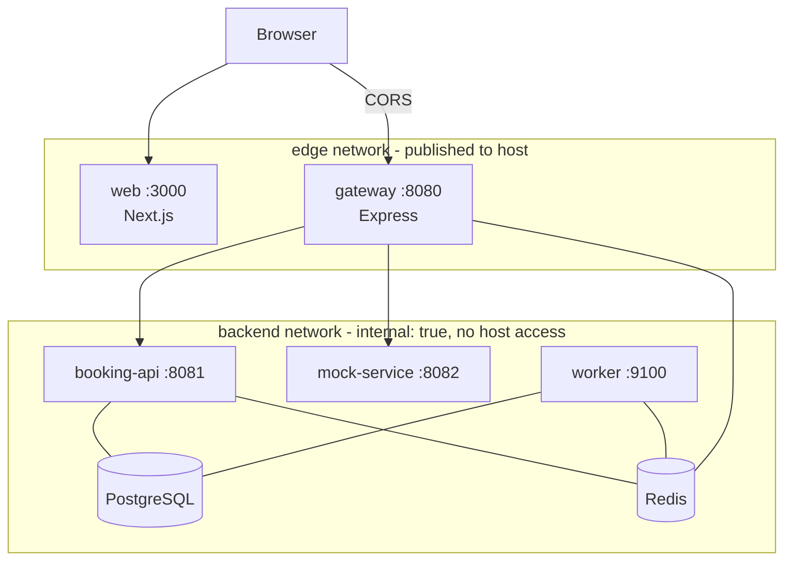

# Architecture

## Overview



The browser loads the UI from `web` and calls the **gateway** for data. The gateway is the only public entry point to the backend. The `backend` network is declared `internal: true`, so PostgreSQL, Redis and the services have no route to or from the outside world and publish no ports (verified with `docker compose config`: only `gateway 8080` and `web 3000` are published).

## Services and responsibilities

| Service | Responsibility | Talks to |
|---|---|---|
| **web** | UI. Holds no secrets, never touches PostgreSQL/Redis. | gateway (from the browser) |
| **gateway** | Request ID, CORS, security headers, **Token Bucket rate limit**, routing, per-attempt timeouts, safe retries, **circuit breaker** (mock), health aggregation, Prometheus metrics, dashboard summary. | booking-api, mock-service, Redis |
| **booking-api** | Business logic: events (cache-aside), bookings (transaction + idempotency), outbox dispatcher, migrations + seed on start. | PostgreSQL, Redis |
| **worker** | Consumes BullMQ jobs, confirms bookings, retries, compensates permanent failures, publishes a heartbeat. | PostgreSQL, Redis |
| **mock-service** | A deliberately unreliable downstream (normal / slow / failing / flaky / switchable outage). | none |
| **PostgreSQL** | Source of truth. Persistent volume `pgdata`. | |
| **Redis** | Rate-limit buckets, cache, BullMQ queue, worker heartbeat and stats. AOF persistence, volume `redisdata`, `noeviction` (required by BullMQ). | |

## Why each component exists

- **Gateway.** One place for cross-cutting policy (limits, timeouts, IDs, metrics) so services stay simple, and one place to shed load before it reaches the database.
- **Redis.** Shared state that must be consistent across gateway instances (token buckets), a fast read cache, and the durable-ish queue backend.
- **Asynchronous workers.** Confirmation (payment, ticket issuing) is slow and can fail. Accepting the booking in PostgreSQL and finishing the slow part later keeps the API fast (~10 ms to accept) and lets work be retried without the user waiting.
- **Outbox.** Writing to PostgreSQL and to Redis cannot be one atomic operation. The outbox row is written in the same transaction as the booking, so a committed booking can never silently lose its follow-up work.

## Failure handling summary

| Failure | Behaviour (all verified by tests in `tests/fault`) |
|---|---|
| Mock/downstream slow or failing | Timeout (504) → retry for GETs → breaker opens → instant 503 `CIRCUIT_OPEN` → HALF_OPEN probe → CLOSED. Browsing and booking are unaffected. |
| Redis down | Rate limiter **fails open** (flagged `X-RateLimit-Status: bypassed`), reads fall back to PostgreSQL, bookings still succeed (outbox row waits), dashboard marks Redis-backed numbers unavailable. After recovery pending outbox rows are published and confirmed. |
| PostgreSQL down | Writes and uncached reads return 503 quickly; health says `postgres: unhealthy`; no process crash; service resumes after restart. |
| Booking API down | Gateway returns a bounded 502 with a safe message; other routes keep working. |
| Worker down / killed | Bookings stay `PROCESSING`, jobs wait in the queue; heartbeat expiry makes health `degraded`; after restart (or after BullMQ stall recovery for a SIGKILL) they complete. |

## Sequence: booking

```mermaid
sequenceDiagram
  participant U as Browser
  participant G as Gateway
  participant A as Booking API
  participant P as PostgreSQL
  participant D as Outbox dispatcher
  participant Q as BullMQ (Redis)
  participant W as Worker
  U->>G: POST /api/bookings (Idempotency-Key, X-Request-Id)
  G->>G: token bucket (Lua) → allow
  G->>A: forward (same request id)
  A->>P: BEGIN; UPDATE events … WHERE available >= qty; INSERT booking; INSERT outbox; COMMIT
  A-->>U: 202 {status: PROCESSING}
  D->>P: SELECT … FOR UPDATE SKIP LOCKED (PENDING)
  D->>Q: add(jobId = booking-<id>)
  D->>P: mark PUBLISHED
  Q->>W: job
  W->>P: UPDATE bookings SET status='CONFIRMED' WHERE status='PROCESSING'
  U->>G: GET /api/bookings/:id (poll)
  G->>A: …
  A-->>U: CONFIRMED
```

## Observability

- Request ID: browser → gateway → booking-api → outbox payload → BullMQ job → worker logs (verified in logs: one id appears in all three services).
- Logs: JSON via pino with `service`, `timestamp`, `level`, `requestId`, `method`, `route`, `status`, `durationMs`; worker lines add `jobId`, `bookingId`, `queue`, `attempt`, `durationMs`, `finalStatus`. Secrets are redacted by path; query strings are never logged (they can contain e-mail addresses).
- Metrics: see [Metrics](#metrics).

## Metrics

`GET /metrics` (gateway, Prometheus text format): `flashsale_http_requests_total{method,route_class,status}`, `flashsale_http_request_duration_seconds`, `flashsale_rate_limited_total`, `flashsale_rate_limiter_errors_total`, `flashsale_upstream_requests_total`, `flashsale_upstream_retries_total`, `flashsale_circuit_breaker_state`, `flashsale_circuit_breaker_transitions_total`, plus Node process metrics. The Booking API and worker expose their own `/metrics` on the internal network (cache lookups, booking outcomes, DB failures, outbox publishes, job counts/durations).

Limitations: gateway counters and the dashboard time series are in process memory (bounded: 120 five-second buckets) and reset on restart; cache and worker counters live in Redis; "completed jobs" is a lifetime counter because BullMQ trims finished jobs. Health/metrics polling is excluded from the traffic counts so the dashboard does not inflate its own numbers. The gateway `/metrics` does not federate the other services (they would need their own scrape targets).
