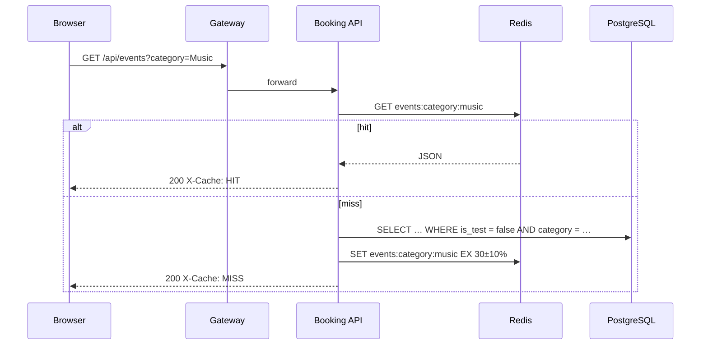
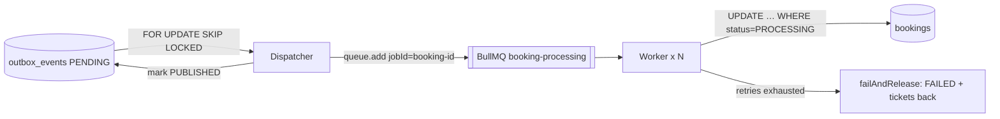

# Data flow

## 1. Browsing events (cache-aside)



Filters (`q`, `city`, price, date, sort) are applied in the API on top of the cached list. A Redis error is logged and counted, and the request is served from PostgreSQL (`meta.cacheError: true`).

## 2. Booking (write path)

1. **Gateway**: assigns/validates `X-Request-Id`, spends one token, buffers the body (≤ 100 kB), forwards headers including `Idempotency-Key`.
2. **Booking API** validates with Zod (`quantity` 1..10, e-mail, UUID, strict keys) and requires `Idempotency-Key`.
3. Fast path: if the key already exists → same fingerprint ⇒ `200` replay of the original booking; different fingerprint ⇒ `422 IDEMPOTENCY_KEY_REUSED`.
4. Transaction (READ COMMITTED):
   ```sql
   INSERT INTO users … ON CONFLICT (email) DO NOTHING;           -- no row lock on conflict
   UPDATE events SET available_capacity = available_capacity - $q,
          status = CASE WHEN available_capacity - $q = 0 THEN 'SOLD_OUT' ELSE status END
    WHERE id=$1 AND status='ON_SALE' AND available_capacity >= $q AND event_date > now()
   RETURNING ticket_price, category;                              -- 0 rows ⇒ 404 / 409
   INSERT INTO bookings (…, idempotency_key UNIQUE …);
   INSERT INTO outbox_events (…);
   COMMIT;
   ```
   Concurrent buyers queue on the event row lock; each re-evaluates `available_capacity >= $q` against the latest committed value. Two requests with the same key both try the insert; the loser hits the `UNIQUE` constraint, its **whole** transaction (including its decrement) rolls back, and it replays the winner's booking.
5. After `COMMIT` (best effort): invalidate `events:all`, `events:featured`, `events:category:*`, `events:{id}` and wake the dispatcher.
6. Response `202 Accepted`:
   ```json
   {"success":true,"message":"Booking accepted for processing","idempotentReplay":false,
    "data":{"bookingId":"…","bookingReference":"FS-XXXXXXXX","status":"PROCESSING","quantity":2,"totalAmount":398,"eventId":"…","statusUrl":"/api/bookings/…"}}
   ```

## 3. Asynchronous confirmation



- Delivery is **at-least-once**; effects are made **idempotent** (deterministic job id, conditional `UPDATE`). Exactly-once *delivery* is not claimed. See [async-processing.md](async-processing.md).
- Worker events (`queue.published`, `job.active`, `job.retry`, `job.completed`, `job.failed`) are appended to a bounded Redis list (300 entries) that feeds the playground log.

## 4. Status read

`GET /api/bookings/:id` reads the booking from PostgreSQL (authoritative) and best-effort adds the BullMQ job state (`waiting|active|delayed|completed|failed`, attempts) with a 600 ms cap. The UI maps it to *Accepted → Queued → Processing → Confirmed/Failed*.

## 5. Health and metrics path

`GET /health/services` (gateway) probes in parallel, each with a 2.5 s cap: Redis `PING`, Booking API `/health/ready` (which reports PostgreSQL and Redis), mock-service `/health`, and worker **heartbeat freshness** (`worker:heartbeat:*` keys, TTL 15 s). PostgreSQL status is taken from the Booking API's report; if the API is unreachable PostgreSQL is reported `unknown` (the gateway does not talk to the database).

Status: `healthy` (all up) · `degraded` (worker or mock down; HTTP 200) · `unhealthy` (gateway, booking-api, postgres or redis down; HTTP 503).
