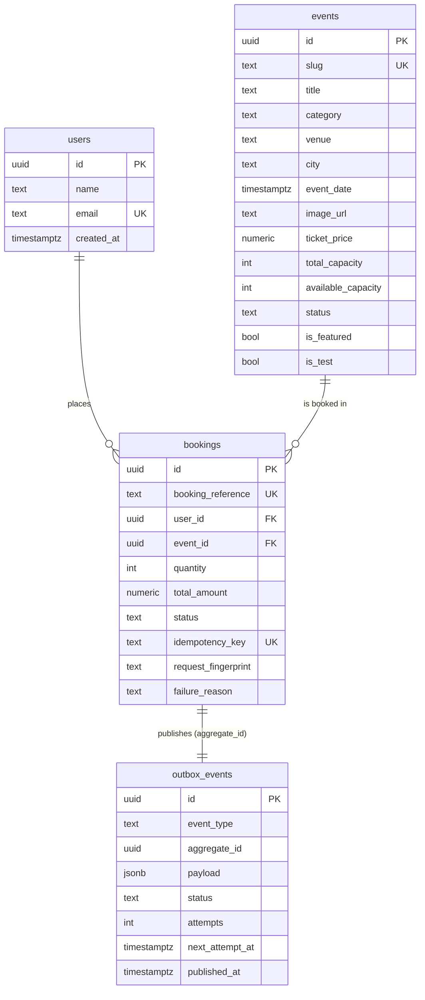

# Database design

PostgreSQL 16. Schema lives in [database/migrations/001_initial_schema.sql](../database/migrations/001_initial_schema.sql); there is no `init.sql`.

## Migrations

- Files `NNN_name.sql` in `database/migrations/`, applied in order, **each in its own transaction**.
- `schema_migrations(version, name, checksum, applied_at)` records what ran. Editing an already-applied file is detected (checksum mismatch) and refused.
- A PostgreSQL advisory lock serialises concurrent migrators (e.g. two scaled `booking-api` replicas).
- Runs automatically on `booking-api` start (`RUN_MIGRATIONS_ON_START`), or manually: `npm run migrate` (add `-- --seed` to seed). Seeds are idempotent (`ON CONFLICT (slug) DO NOTHING`), so restarts never reset inventory.

## Migration 002 - accounts

`002_auth.sql` adds `users.password_hash` (NULL = guest row from an earlier booking) and `users.last_login_at`, and a `sessions` table (`id`, `user_id` -> users ON DELETE CASCADE, `token_hash` UNIQUE, `created_at`, `expires_at`; indexed on user and expiry). It is additive: existing users, bookings and events are untouched.

- **Passwords**: `scrypt$N$r$p$salt$hash` (node:crypto scrypt, N=16384, r=8, p=1, 16-byte random salt per password, 64-byte key). Compared with `timingSafeEqual`.
- **Sessions**: a random 32-byte token (base64url) is given to the client; only its **SHA-256** is stored, so a database leak does not yield usable sessions. TTL `AUTH_SESSION_TTL_HOURS` (default 168). Logging out deletes the row (immediate revocation). At most 10 live sessions per user; expired rows are purged on login.
- **Sign-up** is one atomic statement: `INSERT ... ON CONFLICT (email) DO UPDATE SET password_hash = ... WHERE users.password_hash IS NULL`. The conflict branch only fires for guest rows, so an existing account can never be overwritten, and two concurrent sign-ups for one new e-mail cannot both succeed.

## Tables

## Constraints and why they exist

| Constraint | Purpose |
|---|---|
| `events_capacity_range CHECK (available_capacity BETWEEN 0 AND total_capacity)` | Last line of defence against overselling or over-releasing: the database refuses a bad value even if application code is wrong (tested: direct `UPDATE … = -1` fails). |
| `events.status IN ('ON_SALE','SOLD_OUT','CANCELLED')` | Closed set of states. |
| `bookings.status IN ('PROCESSING','CONFIRMED','FAILED')`, `quantity BETWEEN 1 AND 10`, `total_amount >= 0` | Valid lifecycle and sane amounts. |
| `bookings_idempotency_key_key UNIQUE` | Duplicate client requests cannot create two bookings, even when they arrive at the same instant. |
| `bookings_reference_key UNIQUE` | Human-friendly `FS-XXXXXXXX` references are unique (a collision retries via savepoint). |
| `users.email CHECK (email = lower(email)) UNIQUE` | One user per normalised e-mail. |
| FKs `bookings.user_id`, `bookings.event_id` | Referential integrity. |
| `outbox_events.status IN ('PENDING','PUBLISHED','FAILED')` | Dispatcher state machine. |

## Indexes

| Index | Serves |
|---|---|
| `events_public_listing_idx (event_date) WHERE is_test = FALSE` | listing ordered by date |
| `events_category_idx`, `events_city_idx` (partial, `is_test = FALSE`) | category/city lookups |
| `events_featured_idx (event_date) WHERE is_featured AND is_test = FALSE` | featured rail |
| `bookings_user_created_idx (user_id, created_at DESC)` | "My bookings" |
| `bookings_event_idx (event_id)` | per-event aggregates / FK checks |
| `bookings_status_idx (status) WHERE status = 'PROCESSING'` | find unfinished bookings cheaply |
| `outbox_pending_idx (next_attempt_at, created_at) WHERE status = 'PENDING'` | dispatcher claim query touches only pending rows |
| `outbox_aggregate_idx (aggregate_id)` | lookups by booking |

## Inventory management

Inventory is a single counter on the event row, changed only by:

- **Reserve** (booking transaction): `available_capacity = available_capacity - q WHERE available_capacity >= q`.
- **Release** (worker, permanent failure): `available_capacity + q`, in the same transaction that flips the booking `PROCESSING → FAILED` (so it can happen at most once per booking).

Invariant checked by the test-suite after every concurrency test:
`total_capacity − available_capacity = SUM(quantity) of bookings in PROCESSING or CONFIRMED`, `available_capacity ≥ 0`, and every booking has exactly one outbox row.

## Transaction flow

See [data-flow.md](data-flow.md) §2. Isolation level is READ COMMITTED: the conditional `UPDATE` takes the row lock and, after waiting, re-evaluates its `WHERE` on the freshly committed row, which is what makes the check-and-decrement atomic without `SERIALIZABLE` retries. Hot-row contention (everyone buying the same event) serialises on that one row; that is a throughput ceiling for a single event, discussed in the load-test report.

## Idempotency

`Idempotency-Key` (8–128 chars of `A-Za-z0-9._:-`) is stored on the booking with `request_fingerprint = sha256(eventId|quantity|email)`.

| Situation | Result |
|---|---|
| New key | `202`, booking created |
| Same key, same payload | `200`, original booking, `idempotentReplay: true`, no extra inventory |
| Same key, different payload | `422 IDEMPOTENCY_KEY_REUSED` |
| Request rejected (sold out, validation) | no row is written, so the key can be used again later |
| Same key submitted concurrently | exactly one booking (UNIQUE constraint + rollback of the loser) |

## Outbox pattern

`outbox_events` rows are inserted in the same transaction as the booking. The dispatcher (inside `booking-api`) claims `PENDING` rows with `FOR UPDATE SKIP LOCKED` (safe with multiple dispatchers), enqueues them, and marks them `PUBLISHED`. On enqueue failure the row stays `PENDING` with `attempts+1`, `last_error`, and exponential `next_attempt_at` (cap 30 s). Transport errors never move a row to `FAILED`, so a long Redis outage cannot drop work.

## Money

`NUMERIC(10,2)` / `NUMERIC(12,2)`, returned to JS as numbers (two decimals, far below float precision limits). Currency is INR; no payment is taken.
