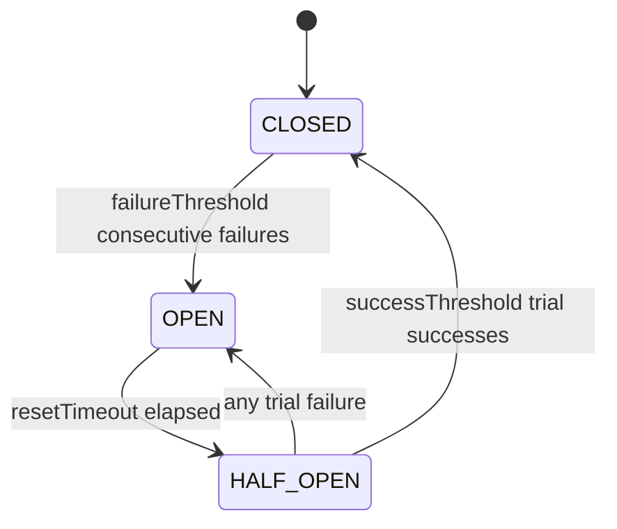

# Fault tolerance

## Circuit breaker

[apps/gateway/src/resilience/circuit-breaker.js](../apps/gateway/src/resilience/circuit-breaker.js). Guards every call from the gateway to the mock downstream (`/mock/*`).

| Setting | Default | Variable |
|---|---|---|
| failure threshold (consecutive) | 3 | `CIRCUIT_FAILURE_THRESHOLD` |
| reset timeout | 10 s | `CIRCUIT_RESET_TIMEOUT_MS` |
| half-open concurrent trials | 1 | `CIRCUIT_HALF_OPEN_MAX_CALLS` |
| success threshold to close | 2 | `CIRCUIT_SUCCESS_THRESHOLD` |
| request timeout | 2.5 s | `MOCK_TIMEOUT_MS` |

A **failure** is a network error, a timeout, or an HTTP status ≥ 500. 4xx counts as success (the dependency is alive). While OPEN, calls are rejected immediately with `503 CIRCUIT_OPEN` + `Retry-After`, without touching the downstream (tested: 0 requests reach it, response in < 100 ms). The open → half-open move is lazy (evaluated on the next call or state read). State, counters and the last 25 transitions are in `GET /gateway/circuit-breaker`, the dashboard, and `flashsale_circuit_breaker_state` / `_transitions_total`.

Scope: the breaker is per gateway process and wraps only the mock route. Booking-API calls are protected by timeouts and bounded retries but not a breaker.

## Retry with exponential backoff

Two places, deliberately different:

1. **Gateway → upstream** ([retry.js](../apps/gateway/src/resilience/retry.js)): up to `RETRY_MAX_ATTEMPTS` (2) attempts, delay = random(0, min(1 s, 100 ms·2ⁿ)) (full jitter). What is retried:
   - `GET/HEAD/OPTIONS`: network errors, timeouts, and **502/503/504** only;
   - `POST`: only if it provably was **not delivered** (connection refused / reset / connect timeout), **or** it carries an `Idempotency-Key` (replays are harmless);
   - never 4xx, never a plain 500 on a write, never when the circuit is open.
   Retries happen *inside* the breaker, so one client call counts as one breaker outcome. `X-Retry-Attempts` reports it.
2. **Worker jobs** (BullMQ): 4 attempts, exponential backoff 1 s/2 s/4 s; permanent errors skip retries.

A short TCP **connect timeout** (`UPSTREAM_CONNECT_TIMEOUT_MS`, 1 s) makes a stopped container fail fast: measured earlier, a dead container's address silently dropped packets and each attempt stalled ~4 s.

## Timeouts

Gateway → API 8 s, → mock 2.5 s, health probes 2.5 s, connect 1 s; PostgreSQL connect 3 s / statement 10 s; Redis commands 500 ms (cache/rate-limit) with fail-fast (no offline queue).

## Failure simulation

Mock service: `/mock/normal`, `/mock/slow`, `/mock/fail`, `/mock/flaky`, `/mock/service` + `POST /mock/control {mode}` for a switchable outage. UI: Playground → *Circuit breaker* (single calls, 5 failing calls, *Start outage → Call dependent service → Recover service*), showing state, failure count, probe countdown and a request log with duration and "failed fast" markers.

## Expected vs. actual behaviour (executed against the Docker stack)

| Failure injected | Expected | Actual (test result) |
|---|---|---|
| Mock slow (4 s) | Gateway cuts it at 2.5 s → 504, retried once, counted as failure | ✔ 504 `UPSTREAM_TIMEOUT`, ~5.6 s total, `X-Retry-Attempts: 2` |
| Mock failing ×3 | Opens; next call fails fast | ✔ states `CLOSED, CLOSED, OPEN`; then `CIRCUIT_OPEN` in < 100 ms |
| Reset timeout passes | HALF_OPEN trial, 2 successes close it | ✔ `OPEN→HALF_OPEN→CLOSED` recorded in history |
| Trial fails in HALF_OPEN | Re-open immediately | ✔ |
| Mock container stopped | Bounded 502/504, breaker opens, system `degraded` (HTTP 200), recovery after start | ✔ |
| Booking/browsing while mock is down | Unaffected | ✔ |
| **Redis down** | Fail-open limiter (`bypassed`), reads from PostgreSQL, bookings accepted, health 503 `unhealthy`, Redis-backed dashboard numbers `n/a`; after restart outbox drains and booking `CONFIRMED` | ✔ |
| **PostgreSQL down** | Booking and uncached reads `503`, quick; `postgres: unhealthy`; API process keeps running; works again after restart | ✔ |
| **Booking API down** | Gateway `502` quickly with no internal addresses; mock route and `/health` still OK; `booking-api: unhealthy`, `postgres: unknown` | ✔ |
| **Worker stopped** | Health `degraded` after heartbeat expiry; bookings wait; finish after start | ✔ |
| **Worker SIGKILL mid-job** | No lost bookings after restart | ✔ all 4 confirmed (stall recovery ≈ 30 s+) |
| Data across restart of every container | Persisted | ✔ confirmed booking and inventory unchanged |

Known gaps: single instance of each service (no HA PostgreSQL/Redis); the breaker's state is not shared between multiple gateway instances; Redis-down means no rate limiting (fail-open by choice).
